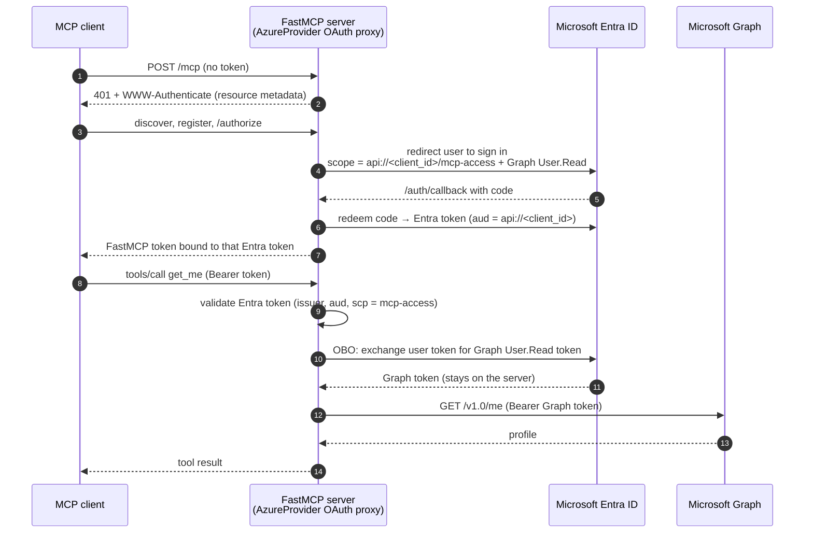
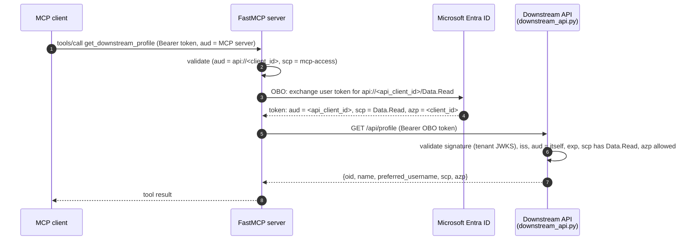

# fastmcp-entra-obo-example

A minimal [FastMCP](https://gofastmcp.com) server secured with Microsoft Entra ID that calls
Microsoft Graph **on behalf of the signed-in user** using the OAuth 2.0 On-Behalf-Of (OBO) flow.
The whole server is [`server.py`](server.py) (~120 lines including comments). It also calls
**your own API** ([`downstream_api.py`](downstream_api.py), ~80 lines) the same way, and that API
shows how to validate the token it receives.

> **Status:** tested offline only: unit tests, the downstream API's token-validation matrix, the
> app-registration script against a fake `az`, and a Docker Compose smoke test in CI. It has
> **not yet been verified end to end against a real Entra tenant**; that is tracked in issue #1.

It shows the pattern recommended by the [FastMCP Azure docs](https://gofastmcp.com/integrations/azure):

- `AzureProvider` (FastMCP's OAuth proxy) signs the user in. The token behind every MCP request is
  for **this server's own API**: audience `api://<client_id>`, scope `mcp-access`
  (`required_scopes=["mcp-access"]`). It is never a Graph token.
- Graph's delegated scope is requested at sign-in via `additional_authorize_scopes`, so the user
  consents once, but it is never advertised to or handed to the MCP client.
- A tool that needs Graph declares `graph_token: str = EntraOBOToken([...])`. FastMCP exchanges the
  user's token for a Graph token (OBO) just for that call.

Tools:

| Tool     | What it does                                                                     |
|----------|----------------------------------------------------------------------------------|
| `whoami` | Returns claims (`name`, `preferred_username`, `oid`, `tid`, `scp`) from the validated incoming token. No Graph call. |
| `get_me` | Gets a Graph token via OBO and calls `GET /v1.0/me` (displayName, mail, userPrincipalName, id). |
| `get_downstream_profile` | Gets a token for your API via OBO and calls `GET /api/profile` on it. Registered only when `API_CLIENT_ID` and `DOWNSTREAM_API_URL` are set. |

Repo layout:

| Path | Purpose |
|------|---------|
| [`server.py`](server.py) | The MCP server: `AzureProvider` auth, OBO tools, HTTP on :8000. |
| [`downstream_api.py`](downstream_api.py) | "Your own API" (Starlette, :8001): validates Entra v2 tokens issued for itself. |
| [`scripts/create_app_registration.sh`](scripts/create_app_registration.sh) | az CLI: creates/updates both app registrations and writes `.env` (`--delete` cleans up). |
| [`scripts/compose_smoke.sh`](scripts/compose_smoke.sh) | Brings up the Compose stack with dummy values and checks auth is enforced. |
| [`Dockerfile`](Dockerfile), [`compose.yaml`](compose.yaml) | One image for both processes; Compose runs the server and the API. |
| [`.env.example`](.env.example) | Every setting, documented; copy to `.env`. |
| [`tests/`](tests) | Offline tests (no network, no tenant). |
| [`.github/workflows/ci.yml`](.github/workflows/ci.yml) | CI: lint + tests, shellcheck + Compose smoke test. |
| [`pyproject.toml`](pyproject.toml), [`uv.lock`](uv.lock) | Dependencies (FastMCP pinned exactly, see [Production notes](#10-production-notes)). |

## How it works



## 1. Prerequisites

- Python 3.12+ and [uv](https://docs.astral.sh/uv/) (to run on your machine).
- Docker with Compose (optional, to run in containers).
- The [az CLI](https://learn.microsoft.com/cli/azure/install-azure-cli) and `python3` (for the
  app-registration script), or use the Azure portal instead.
- An Entra tenant where you can create app registrations, and, if users there can't consent to
  apps themselves, an admin who can grant consent.

## 2. App registration

You need one single-tenant app registration with a client secret for the MCP server, plus one
(no secret) for the downstream API if you want `get_downstream_profile`.

### With the script (az CLI)

```bash
az login
scripts/create_app_registration.sh          # APP_NAME / BASE_URL env vars override defaults
scripts/create_app_registration.sh --delete  # clean up later
```

It creates (or updates, if one with the same display name exists) both apps (`$APP_NAME` and
`$APP_NAME-api`), then writes `AZURE_TENANT_ID`, `AZURE_CLIENT_ID`, `AZURE_CLIENT_SECRET`,
`API_CLIENT_ID`, `DOWNSTREAM_API_URL` and `ALLOWED_CLIENT_IDS` to `.env` (mode 600). The secret is
never printed; re-runs reuse it unless `NEW_SECRET=1`.

### In the Azure portal

1. **Entra ID → App registrations → New registration**: single tenant; redirect URI platform
   **Web**, `http://localhost:8000/auth/callback`.
2. **Expose an API**: set the Application ID URI to `api://<client_id>`; add scope `mcp-access`
   (who can consent: admins and users).
3. **Manifest**: set `"requestedAccessTokenVersion": 2` (under `api` in the Microsoft Graph manifest).
4. **API permissions → Add → Microsoft Graph → Delegated → `User.Read`**. Use delegated
   permissions only: application permissions bypass the user.
5. **Certificates & secrets → New client secret**.
6. Copy `.env.example` to `.env` and fill in tenant ID, client ID and secret.
7. Optional downstream API: see [Calling your own API](#7-calling-your-own-api-downstream).

## 3. Configuration

Both processes read the environment, then `.env` (variables already in the environment win).
[`.env.example`](.env.example) lists every key. "Script" = `create_app_registration.sh` writes it.

| Variable | Used by | Required | Default | Set by |
|----------|---------|----------|---------|--------|
| `AZURE_TENANT_ID` | server; API (fallback for `API_TENANT_ID`) | server: yes | none | script / you |
| `AZURE_CLIENT_ID` | server | yes | none | script / you |
| `AZURE_CLIENT_SECRET` | server | yes | none | script / you |
| `BASE_URL` | server (public URL, redirect URI = `${BASE_URL}/auth/callback`) | no | `http://localhost:8000` | you (the script reads it for the redirect URI but doesn't write it) |
| `API_CLIENT_ID` | server (enables `get_downstream_profile`); API (its own audience) | API: yes | server: unset = Graph only | script / you; Compose gives the API container a placeholder if unset |
| `DOWNSTREAM_API_URL` | server | no (needed for `get_downstream_profile`) | unset | script (`http://localhost:8001`); Compose overrides with `http://downstream-api:8001` |
| `API_SCOPE` | server (OBO scope) and API (`scp` check) | no | `Data.Read` | you (the script always registers `Data.Read`) |
| `API_TENANT_ID` | API | no | `AZURE_TENANT_ID` | you |
| `ALLOWED_CLIENT_IDS` | API (comma-separated allowed `azp` values) | no | unset = any caller app | script (the MCP app's client ID) |
| `HOST` | server and API (bind address) | no | `127.0.0.1` | Compose (`0.0.0.0`) |
| `FASTMCP_HOME` | server (read by FastMCP: OAuth proxy storage) | no | your OS user data dir for `fastmcp` | the image (`/data`, a volume) |

Ports are fixed: server 8000, API 8001.

## 4. Run locally

```bash
uv sync
uv run server.py        # streamable HTTP on http://localhost:8000/mcp
```

Missing settings fail fast, e.g. `Missing required environment variable(s): AZURE_CLIENT_SECRET`.
To run the downstream API too, see [Calling your own API](#7-calling-your-own-api-downstream).

## 5. Run with Docker

One image runs both processes; Compose starts the MCP server (:8000) and the downstream API (:8001).
Run the script first if you want `get_downstream_profile`: with a hand-filled Graph-only `.env`,
the API container starts with a placeholder client ID and the MCP server registers only the Graph
tools.

```bash
scripts/create_app_registration.sh   # or: cp .env.example .env and fill it in
docker compose up --build
```

Connect your MCP client to `http://localhost:8000/mcp` (see below). `BASE_URL` stays
`http://localhost:8000` because your browser and client use the published host port, so that
redirect URI (`http://localhost:8000/auth/callback`) must match the app registration. Inside
Compose the server reaches the API at `http://downstream-api:8001` (set in `compose.yaml`).
FastMCP's OAuth proxy storage lives in the `oauth-state` volume (`FASTMCP_HOME=/data`), so
restarts don't force re-registration. Stop with `docker compose down -v` (`-v` also deletes it).

## 6. Connect a client

**MCP Inspector**: `npx @modelcontextprotocol/inspector`, choose *Streamable HTTP*, URL
`http://localhost:8000/mcp`, then connect. You'll see FastMCP's consent page, then the Microsoft
sign-in. Call `whoami`, then `get_me`, and `get_downstream_profile` if the API is configured.

**Claude Code**:

```bash
claude mcp add --transport http entra-obo http://localhost:8000/mcp
```

Then run `/mcp` in Claude Code to authenticate, and ask it to call `get_me` (or
`get_downstream_profile`).

## 7. Calling your own API (downstream)

`get_downstream_profile` shows the MCP server calling "the underlying application", an API you own,
on behalf of the user. The API is a separate app registration, `api://<api_client_id>`, exposing a
delegated scope `Data.Read`.



The rules:

- The MCP server **never forwards** the token it received: its audience is the MCP server, so the
  API must reject it. The server exchanges it via OBO, **one token per downstream resource**.
- The API validates like any resource server: signature against the tenant keys
  (`https://login.microsoftonline.com/<tenant>/discovery/v2.0/keys`), issuer
  `https://login.microsoftonline.com/<tenant>/v2.0`, audience = **itself**, expiry, and the
  delegated scope in `scp` (403 if missing). In v2 tokens `aud` is the API's client ID (a GUID),
  not `api://...`; that's why the API app sets `requestedAccessTokenVersion: 2`.
- `azp` is the client ID of the app that requested the token: the MCP server. `oid` is still the
  user, so the API knows who is calling *and* through which app.
- **Restrict the caller with `ALLOWED_CLIENT_IDS`.** Without it, any app in the tenant that gets a
  `Data.Read` token for the API (e.g. one a user consented to) can call it. Set it to the MCP
  server's client ID (the script does); other callers get 403 `unauthorized_client`.
- The API scope is added to `additional_authorize_scopes` (OBO scopes must be a subset). Entra
  allows scopes for several resources at sign-in, but a token request may target only one
  (`AADSTS28000`); FastMCP redeems the sign-in code (and refreshes) for the MCP server's own scope
  only (plus OIDC scopes), so this is safe. That is FastMCP implementation behaviour, not a
  documented contract, so `fastmcp` is pinned exactly; re-check it before upgrading. None of these
  scopes is advertised to the MCP client.
- Consent: the API app **pre-authorizes** the MCP app for `Data.Read`
  (`api.preAuthorizedApplications`), so users are never asked to consent to it and the OBO call
  doesn't fail with `AADSTS65001`. The script also adds the permission to the MCP app's API
  permissions so it is visible there and covered by `admin-consent`.
- Pre-authorization vs. sign-in scope: the API scope is also requested at sign-in so that user
  consent and the subset rule hold even without pre-authorization. With pre-authorization (what the
  script sets up) it is probably not required at sign-in. This is **unverified against a live
  tenant** (issue #1); the example keeps it.

Portal steps (the script does all of this): register `<name>-api` (single tenant, no redirect URI,
no secret); **Expose an API**: Application ID URI `api://<api_client_id>`, scope `Data.Read`, then
**Add a client application** with the MCP server's client ID and that scope; **Manifest**:
`"requestedAccessTokenVersion": 2`; on the MCP app, **API permissions → My APIs → `<name>-api` →
`Data.Read`**. Put `API_CLIENT_ID`, `DOWNSTREAM_API_URL=http://localhost:8001` and
`ALLOWED_CLIENT_IDS=<client_id>` in `.env`.

Run both processes:

```bash
uv run downstream_api.py   # http://localhost:8001/api/profile
uv run server.py           # http://localhost:8000/mcp
```

## 8. Why OBO and not token passthrough

- The MCP spec **forbids token passthrough**: a server must only accept tokens issued for itself and
  must not forward the client's token to upstream APIs
  ([security best practices](https://modelcontextprotocol.io/specification/2025-06-18/basic/security_best_practices#token-passthrough)).
- Tokens are **audience-bound**. The token the client presents is for `api://<client_id>`, so the
  server can validate it (issuer, audience, `scp`). A Graph token's audience is Graph, so your API
  can't (and shouldn't) accept it.
- Microsoft: tokens for Microsoft Graph are not meant to be validated or consumed by your own API;
  your API validates only tokens issued for it
  ([access tokens](https://learn.microsoft.com/entra/identity-platform/access-tokens)).
- OBO keeps the user's identity and consent end to end: the Graph token is issued for this user and
  only the delegated scopes they consented to, and it never leaves the server.

## 9. Troubleshooting

Errors are generic on purpose: tools return e.g. `Microsoft Graph request failed (403)` and the API
returns `invalid or expired token`. The detail (response body, PyJWT reason) is in that process's
log.

| Symptom | Fix |
|---------|-----|
| `AADSTS65001` (user or admin has not consented) during the OBO call | The user hasn't consented to Graph `User.Read`. Sign in again (it's requested at sign-in via `additional_authorize_scopes`) or grant admin consent: `az ad app permission admin-consent --id <client_id>`. |
| OBO fails for a scope | Scopes passed to `EntraOBOToken` must be a subset of `additional_authorize_scopes`, and the app must have that delegated permission. |
| 401 on every call / issuer or audience mismatch | Set `"requestedAccessTokenVersion": 2` in the manifest. v1 tokens have a different issuer and audience. |
| `AADSTS50011` redirect URI mismatch | The app's **Web** redirect URI must exactly equal `${BASE_URL}/auth/callback`. |
| `AADSTS500011` / invalid scope `mcp-access` | Set the Application ID URI to `api://<client_id>` and expose the `mcp-access` scope. |
| `AADSTS65001` on the OBO call for `api://<api_client_id>/Data.Read` | Pre-authorize the MCP app on the API app (Expose an API → Add a client application) or grant admin consent for the MCP app. |
| `AADSTS28000` (scopes for multiple resources) | A token request may target one resource only. Don't put another API's scopes in `required_scopes`; use `additional_authorize_scopes`, and one `EntraOBOToken` per resource. |
| Downstream API returns 401; its log says `InvalidAudienceError` / `InvalidIssuerError` | The API app must issue v2 tokens (`"requestedAccessTokenVersion": 2`): v1 tokens have `aud = api://...` and issuer `https://sts.windows.net/<tenant>/`. Check `API_CLIENT_ID` is the API app's client ID, not the MCP server's. |
| Downstream API returns 403 `insufficient_scope` | The token's `scp` lacks `Data.Read`: the OBO scope must be `api://<api_client_id>/Data.Read` and match `API_SCOPE`. |
| Downstream API returns 403 `unauthorized_client` | The token's `azp` isn't in `ALLOWED_CLIENT_IDS`: set it to the MCP server's `AZURE_CLIENT_ID`. |
| Everyone must sign in again after a restart | The client secret changed, see [Production notes](#10-production-notes). |

## 10. Production notes

This is a local example. Before deploying:

- Serve over **HTTPS**, set `BASE_URL` to the public URL and update the redirect URI.
- Set **`ALLOWED_CLIENT_IDS`** on the API to the MCP server's client ID.
- Keep errors **generic** to callers (as here) and the detail in server logs; never log tokens.
- **Rotating `AZURE_CLIENT_SECRET` signs everyone out.** With no `jwt_signing_key`, FastMCP 4.1.8
  derives its JWT signing key from the client secret, and the encryption key (and directory) of its
  default OAuth proxy storage from that signing key. A new secret invalidates every FastMCP token
  and makes the stored client registrations and upstream tokens unreadable, so clients register
  again and users sign in again. To rotate without that, give `AzureProvider` a dedicated
  `jwt_signing_key`: FastMCP derives its storage encryption key and directory from it, so both
  stay stable. (A custom `client_storage` is used as-is, not encrypted by FastMCP.)
- `fastmcp` is pinned to an exact version because this example relies on how `AzureProvider`
  picks scopes at code redemption and refresh (see [Calling your own API](#7-calling-your-own-api-downstream));
  re-check that before bumping.

## 11. Testing

```bash
uv run pytest -q                                   # 32 tests; no network, no tenant
uv run ruff check . && uv run ruff format --check .
shellcheck scripts/*.sh
scripts/compose_smoke.sh                           # needs Docker; also runs in CI
```

The offline tests cover: config, scopes and tools (HTTP mocked), including generic tool errors with
the detail only logged; the downstream API's full token-validation matrix, using a locally generated
RSA key, plus the `ALLOWED_CLIENT_IDS` allow-list and generic 401s; and the app-registration
script, run against a fake `az`. `compose_smoke.sh` builds the stack with dummy values and checks
that auth is enforced (PRM advertises only `mcp-access`, `/mcp` and the API return 401 without a
token). Live verification against a real tenant is tracked in issue #1.

## Links

- FastMCP: [Azure (Microsoft Entra) integration](https://gofastmcp.com/integrations/azure), including the OBO section
- Microsoft: [On-Behalf-Of flow](https://learn.microsoft.com/entra/identity-platform/v2-oauth2-on-behalf-of-flow)
- MCP: [Security best practices](https://modelcontextprotocol.io/specification/2025-06-18/basic/security_best_practices) and [Authorization](https://modelcontextprotocol.io/specification/2025-06-18/basic/authorization)

## License

MIT, see [LICENSE](LICENSE).
